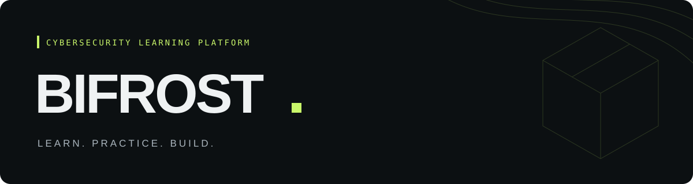

  

<h3 align="center">보안을 이해하고, 직접 실습하고, 나만의 결과물로.</h3>

  BIFROST는 보안의 기초부터 분야별 실습과 프로젝트까지 이어지는 학습 사이트입니다. 
  관심 있는 분야를 탐색하고, 나에게 맞는 경로로 차근차근 배울 수 있습니다.

  <a href="https://lokistday.github.io/bifrost/"><strong>사이트 방문 ↗</strong></a>
  &nbsp; · &nbsp;
  <a href="https://lokistday.github.io/bifrost/learn/">학습 경로</a>
  &nbsp; · &nbsp;
  <a href="https://lokistday.github.io/bifrost/projects/">프로젝트</a>
  &nbsp; · &nbsp;
  <a href="https://lokistday.github.io/bifrost/exams/">모의고사</a>

---

| LEARN | PRACTICE | BUILD |
| :--- | :--- | :--- |
| 개념과 시각 자료로 원리를 이해합니다. | 예제와 제공 자료로 직접 확인합니다. | 종합 프로젝트로 배운 내용을 연결합니다. |

  공통 기초 · 웹 보안 · 시스템 보안 · 디지털 포렌식 · 네트워크 보안 
  클라우드 보안 · 암호학 · 리버싱 · 문제 해결과 자동화

BIFROST / by. Loki

